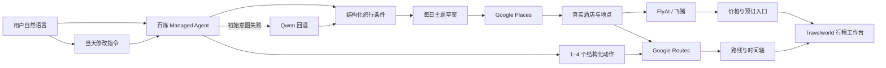

# Travelworld

> 用自然语言描述旅行愿望，将它转换为经过真实地点验证、具有酒店锚点、交通路线和时间约束的每日行程。

Travelworld 是一个面向真实旅行决策的 AI 行程规划原型。目前以新加坡为首个完整案例，将阿里云百炼 Managed Agent、Qwen、Google Places、Google Routes 与 FlyAI/飞猪能力组合在同一条规划流程中。

它不只生成一段“看起来合理”的旅行文案，而是尝试回答这些更实际的问题：

- 用户没有一次提供完整条件时，系统能否持续追问并保留上下文？
- 酒店能否成为每天真实的出发与返回锚点？
- AI 推荐的地点是否真实存在，并位于正确城市？
- 每段交通时间能否通过路线服务重新计算？
- 行程能否遵守每日出发和返店时间？
- 用户能否用一句话修改任意一天，并重新计算当天路线？
- 酒店和景点能否补充有来源的价格与预订入口？
- 当外部服务不可用时，系统能否明确降级，而不是编造结果？

## Online Demo

- [Travelworld 产品首页](https://hello-travel-26915.vocal-fern-4292.chatgpt.site/travel)
- [新加坡四日真实案例](https://hello-travel-26915.vocal-fern-4292.chatgpt.site/travel/demo-singapore#case-walkthrough)
- [创建新加坡行程](https://hello-travel-26915.vocal-fern-4292.chatgpt.site/travel/new)

在线 Demo 运行于 ChatGPT Sites。GitHub 仓库用于公开经过清理的源代码；项目包含服务端 API、AI 调用、Google 路线查询和受保护的密钥，因此不能作为纯静态 GitHub Pages 应用运行。

## 推荐体验顺序

### 1. 浏览产品首页

首页概括了 Travelworld 的核心流程：

```text
表达旅行愿望
→ 补齐必要条件
→ 确认酒店锚点
→ 生成每日草案
→ 验证真实地点
→ 计算实际路线
→ 查看价格与详情
→ 使用自然语言继续修改
```

### 2. 浏览新加坡完整案例

案例页以滚动叙事展示：

- 旅行条件如何被结构化
- 酒店如何成为每日路线锚点
- 四天行程如何按时间推进
- Google Places 与 Google Routes 各自负责什么
- 酒店与景点详情如何呈现
- FlyAI/飞猪价格和预订入口
- 分段住宿
- 一句话局部修改
- 修改后的路线与时间重新计算

### 3. 创建自己的行程

可以直接使用：

```text
我和伴侣两位成人，2026 年 12 月 20 日至 23 日去新加坡，
住 Bugis 附近；每天 09:30 出发、21:00 回酒店，
节奏轻松，喜欢建筑、美食和夜景。
```

或者：

```text
2026 年 12 月 20 日至 23 日，2 位成人，住 Bugis；
每天 10:00 出发、20:30 回酒店，节奏轻松，
酒店预算约 S$250/晚。
```

完成条件确认后，可以继续：

1. 比较 Google 验证的酒店候选。
2. 查看按指定日期与人数查询的酒店参考价。
3. 选择全程住宿酒店。
4. 生成四天真实地点、路线与时间轴。
5. 查看酒店、景点或餐厅详情。
6. 设置某一天开始更换住宿，形成分段住宿。
7. 使用自然语言修改当前选中的一天。
8. 检查修改后的路线是否仍符合返店时间。

## 产品目标

传统 AI 旅行规划可能包含：

- 不准确或不存在的地点
- 只作为普通停留点、没有参与路线计算的酒店
- 没有计算地点之间的真实交通时间
- 与用户要求不一致的结束时间
- 修改一个地点后没有重新计算后续时间
- 没有可靠来源的价格与预订链接
- 没有区分事实、建议和实时数据

Travelworld 把自然语言理解与事实服务分开：

| 信息 | 主要来源 | Travelworld 的处理 |
|---|---|---|
| 初始旅行意图 | 百炼 Managed Agent，失败时直连 Qwen 回退 | 提取日期、人数、住宿、时间、节奏与兴趣 |
| 地点身份 | Google Places | 验证名称、地址、坐标、类别与营业信息 |
| 交通路线 | Google Routes | 计算距离、交通方式与预计时间 |
| 酒店和景点商品 | FlyAI / 飞猪 | 提供可用时的参考价和预订入口 |
| 行程时间轴 | Travelworld | 组合停留时间、交通时间与返店约束 |
| 当天局部修改 | 百炼 Managed Agent + Travelworld | 把自然语言转换为结构化修改动作并重新排程 |

核心原则：

> AI 负责理解与组织；专业数据服务负责地点、路线和价格等事实。

## 核心功能

### 多轮旅行意图收集

生成真实行程前，Travelworld 会检查：

- 准确出行日期
- 同行人数
- 住宿区域或意向酒店
- 每日出发时间
- 每日返店时间
- 旅行节奏
- 兴趣偏好

如果用户一次只补充部分信息，系统会保留已经识别的内容，并继续询问仍然缺失的条件。

初始规划优先调用百炼 Managed Agent；当其结构化输出不可用时，系统可以回退到直连 Qwen。行程生成后的局部修改目前依赖百炼 Managed Agent，不使用 Qwen 回退。

### 每日草案

条件完整后，系统先形成每天的大方向：

```text
Day 1：滨海城市初印象 · 建筑
Day 2：老街区与本地味道
Day 3：花园、艺术与慢节奏 · 夜景
Day 4：南部海湾与旅程收束
```

草案阶段强调主题和区域；实际进入地图的地点仍需经过 Google Places 验证。

### 真实酒店候选

酒店流程分为两层：

1. Google Places 验证酒店名称、地址和位置。
2. FlyAI/飞猪根据入住日期、离店日期和人数查询可展示商品。

最多五家酒店可以在同一个临时智能体会话中依次查询，以减少重复创建会话的成本。

普通规划器按实际结果展示价格和/或 HTTPS 预订入口。无法可靠匹配时，系统返回 unavailable，不会借用附近酒店的报价。为了保证公开案例的展示一致性，案例接口只有在价格和 HTTPS 预订链接同时存在时才标记为可用。

### 酒店作为路线锚点

确认酒店后，每一天按照以下结构生成：

```text
当天住宿酒店
→ 景点或餐厅
→ 后续地点
→ 当天住宿酒店
```

酒店不是普通停留点，而是当天路线的出发与返回锚点。

### 分段住宿

用户可以从指定日期开始更换酒店：

```text
Day 1：Village Hotel Bugis
Day 2：Village Hotel Bugis
Day 3：Marina Bay 酒店
Day 4：Marina Bay 酒店
```

换酒店当天会从上一晚酒店出发，并在新酒店结束。受影响日期的路线与时间会重新计算。

### Google 验证的地点

进入地图的酒店、景点和餐厅均通过 Google Places 验证，并保留可用的：

- 地点名称
- 类别
- 地址
- 经纬度
- Google 评分
- 评价数量
- 营业信息
- Google Maps 链接

地点身份与坐标不由语言模型虚构。

### 路线与时间约束

Google Routes 接口支持步行、公共交通、驾车与骑行查询；当前行程工作台主要呈现步行、公共交通和出租车等出行方式。

系统将路线耗时与停留时间组合为当天时间轴，并检查能否在要求的时间前返回酒店：

```text
09:30 从酒店出发
10:11 到达第一个地点
12:26 前往下一个地点
19:24 开始返程
21:00 前回到酒店
```

### 地点详情与价格边界

酒店详情可以包含：

- 酒店身份与地址
- Google 评分
- 当天住宿说明
- FlyAI/飞猪参考价
- Google Maps 链接
- 可用时的预订入口

景点详情可以包含：

- 景点类别
- 地址与营业信息
- 行程中的安排理由
- 可用时的门票或体验参考价
- Google Maps 与飞猪入口

公开案例使用固定到访日期查询景点商品。普通行程中的景点商品目前按需查询，完整的日期化商品查询仍属于后续工作。

餐厅详情只展示真实地点、地址、评分和营业信息。当前产品路由不会对餐厅发起 FlyAI 查询，因为当前接入范围不包含普通餐厅及餐饮团购商品；系统不会为补全界面而虚构餐饮价格。

### 一句话修改当天行程

地图生成后，可以输入：

```text
把 Day 1 的甜品店换成咖啡店，并删除第二个景点。
```

```text
在 Day 3 的自由活动时间里再安排两个建筑或夜景地点。
```

```text
把 Day 4 的最后一个景点换成更靠近酒店的地方。
```

一次请求支持对同一天执行 1–4 个动作。服务端把全部动作统一到显式指定的 `Day N`、`第 N 天`，或当前选中的日期；成功后只更新目标日，并重新计算：

- 地点顺序
- 交通方式
- 每段耗时
- 到达与离开时间
- 剩余自由时间
- 返店时间

初始行程仍可包含餐厅；为了突出可验证的景点能力，并避免不可用的餐饮商品查询，Day 内自动新增、替换或填充目前只选择非餐饮地点。

跨多个 Day 的单次修改会被拒绝，并提示拆分请求。相对日期和自然日期表达的识别能力仍有限。

## 系统架构



### 数据职责

- 百炼 Managed Agent 负责初始意图和当天修改意图。
- Qwen 为初始意图提供兼容回退。
- Google Places 是地点名称、地址和坐标的事实来源。
- Google Routes 是交通距离与耗时的计算来源。
- FlyAI/飞猪只补充可验证的商品、价格和预订链接。
- Travelworld 负责约束检查、时间轴组合和界面呈现。

## 故障降级

- 百炼初始意图不可用：尝试 Qwen 回退；局部修改则返回明确不可用状态。
- FlyAI 不可用：保留 Google 验证的酒店、地点和路线，只隐藏报价。
- 酒店无法匹配：返回 unavailable，不借用其他酒店价格。
- 景点没有商品：保留地点详情，不虚构门票。
- Google Places 不可用：停止生成真实地点，不把 AI 文本当作地图事实。
- Google Routes 不可用：不伪造路线时间。
- 修改后无法按时返店：减少活动，或提示调整返店时间。

## 技术栈

- React 19
- Next.js 16
- Vinext / Vite
- TypeScript
- Cloudflare Workers
- Tailwind CSS
- Google Maps JavaScript API
- Google Places API
- Google Routes API
- Alibaba Cloud Bailian Managed Agent
- Qwen
- FlyAI / Fliggy
- pnpm

## 项目结构

```text
app/
├─ travel/
│  ├─ page.tsx                         # 产品首页
│  ├─ new/                             # 自然语言规划器
│  ├─ demo-singapore/                  # 新加坡完整案例
│  └─ [tripId]/                        # 已生成行程工作台
└─ api/
   ├─ map-config/                      # 受限制的浏览器地图配置
   └─ travel/singapore/
      ├─ intent/                       # 初始意图理解
      ├─ plan/                         # 行程生成
      ├─ places/                       # 地点查询
      ├─ routes/                       # 路线计算
      ├─ hotel-quotes/                 # 酒店报价
      ├─ poi-commerce/                 # 景点商品查询
      ├─ case-commerce/                # 案例页商品查询
      ├─ revise/                       # 当天一句话修改
      └─ reanchor/                     # 更换住宿锚点

components/travel/                     # 地图和旅行组件
lib/travel/                            # 领域逻辑及外部服务适配
public/travel-case/                    # 案例页实景图片
TRAVEL_CASE_IMAGE_CREDITS.md           # 图片来源与许可
```

## 本地运行

### 环境要求

- Node.js `>= 22.13.0`
- pnpm `11.x`
- Git

### 安装

```bash
pnpm install
```

### 配置环境变量

macOS / Linux：

```bash
cp .env.example .env.local
```

Windows PowerShell：

```powershell
Copy-Item .env.example .env.local
```

`.env.example` 只包含变量名。请填入自己的服务配置，不要提交真实值。

| 变量 | 用途 | 暴露范围 |
|---|---|---|
| `DASHSCOPE_API_KEY` | 百炼 Managed Agent 与直连 Qwen | 服务端 |
| `BAILIAN_API_BASE_URL` | 当前百炼工作空间的 Agent Studio API 地址 | 服务端 |
| `BAILIAN_AGENT_ID` | 百炼智能体 ID | 服务端配置 |
| `BAILIAN_ENVIRONMENT_ID` | 百炼运行环境 ID | 服务端配置 |
| `FLYAI_API_KEY` | 临时会话中的 FlyAI 查询 | 服务端 |
| `GOOGLE_MAPS_SERVER_KEY` | Places 与 Routes | 服务端 |
| `GOOGLE_MAPS_BROWSER_KEY` | 地图渲染 | 浏览器；必须限制域名和 API |
| `QWEN_API_KEY` | `DASHSCOPE_API_KEY` 的兼容回退变量名 | 服务端，可选 |
| `QWEN_API_URL` | 自定义 Qwen 兼容端点 | 服务端，可选 |
| `QWEN_MODEL` | 模型名称，默认 `qwen3.8-flash` | 服务端，可选 |

`BAILIAN_API_BASE_URL` 必须使用 HTTPS，并符合：

```text
https://{workspace_id}.cn-beijing.maas.aliyuncs.com/api/v1/agentstudio
```

Workspace ID 已包含在域名中，不需要再作为单独请求字段发送。

### 启动开发环境

```bash
pnpm dev
```

打开：

```text
http://localhost:5173/travel
```

### 检查与构建

```bash
pnpm lint
pnpm build
```

未配置外部 API 时，页面可以启动，但真实地图、AI 意图理解、路线和商品查询会显示为不可用或降级状态。

## 部署说明

该项目使用服务端 API，部署平台必须支持 Vinext/Cloudflare Worker 运行时或提供等价的服务端能力。

生产部署时：

1. 在托管平台中配置环境变量，不要把值写进仓库。
2. 为 Google Browser Key 配置 HTTP referrer 和 API 限制。
3. 为 Google Server Key 配置 API、配额及适用的服务端限制。
4. 将 FlyAI Key、百炼 Key 与 Google Server Key 保持为服务端秘密。
5. 部署后重新验证地图、报价、外部预订链接和 API 降级路径。

## 安全设计

- 百炼、Qwen、FlyAI 和 Google 服务端凭据只在服务端读取。
- `FLYAI_API_KEY` 只注入临时智能体会话，不返回浏览器。
- 百炼调用日志不记录提示词、输出、Session ID 或凭据。
- 报价链接必须使用 HTTPS。
- 关键 API 输入及外部返回的核心字段经过 schema、长度或范围校验。
- 地点需通过 Google Places 验证后才能进入地图。
- 无法可靠匹配的报价默认不展示。
- `.env*`、部署包、缓存、日志与本地运行状态被 Git 忽略。
- `GOOGLE_MAPS_BROWSER_KEY` 会在浏览器使用，必须通过 Google Cloud 做域名与 API 限制。

## 已知限制

当前版本仍是以新加坡为中心的产品原型：

- 城市边界、地点筛选和提示词针对新加坡优化。
- 模糊意图有时仍需要进一步说明。
- 一次局部修改仅支持同一天的 1–4 个动作。
- 跨天修改、相对日期和自然日期表达能力有限。
- 自由活动与缓冲时间的自动填充仍可能偏保守。
- 普通景点商品查询尚未完整携带行程到访日期。
- 营业时间、交通、库存与价格会实时变化。
- 当前预订通过外部链接完成，尚未形成站内订单闭环。
- 路线耗时是 API 估算，实际出行仍需结合当天情况。

## Future Work

以下内容是尚未实现的路线图。

### 1. 从新加坡扩展到更多目的地

当前城市边界、兴趣分类和案例内容主要针对新加坡。下一阶段将把城市差异抽象为 Destination Profile：

```text
目的地边界
时区与货币
语言与地名
公共交通方式
每日节奏
酒店搜索规则
景点分类
数据供应商
本地旅行约束
```

借助城市适配层，可逐步扩展至东京、首尔、曼谷、香港或上海，而不需要复制整套规划逻辑。同时计划建立统一供应商接口，使地点、酒店、交通和商品查询可以替换或组合不同数据源。

### 2. 增强意图理解与按天细分

当前系统已经能够提取整体日期、人数、住宿、每日时间、节奏和兴趣，但仍存在：

- “多安排一些项目”等模糊表达缺少明确数量
- 兴趣通常停留在整段旅行层面
- 每一天的主题与用户具体意图之间还不够细致
- 自由活动与缓冲时间有时没有转化为适合当天区域的活动
- 跨天修改和相对日期表达仍可能产生歧义

未来将采用分层意图模型：

```text
Trip-level Intent
    ↓
Day-level Intent
    ↓
Time-slot Intent
    ↓
Stop-level Constraints
```

系统会先理解整个旅程，再将偏好分配到每天和具体时间段：

```text
Day 1：城市建筑 + 滨海夜景
Day 2：历史街区 + 本地餐饮
Day 3：花园 + 艺术空间
Day 4：海岸景观 + 轻松收尾
```

计划增强：

- 模糊意图澄清
- 按天兴趣分配
- 自由时间自动填充
- 跨天批量修改
- 多动作原子执行
- 相对日期理解
- 修改冲突检测
- 基于真实案例的意图解析评测集

### 3. 实时自适应行程与预订闭环

当前行程在生成或修改时计算路线，但尚未根据旅行当天的变化主动更新。

未来版本计划接入：

- 实时交通变化
- 天气和降雨预报
- 景点临时关闭
- 营业时间变化
- 酒店和门票库存
- 价格波动
- 用户当前位置
- 实际行程延误

当地点不可到达或时间不足时，系统可以解释原因并提供替代方案：

```text
原计划地点临时不可用
→ 在相同区域寻找同类型地点
→ 比较营业时间与交通时间
→ 替换地点
→ 重新计算后续路线
→ 保持原定返店时间
```

商业流程也将从查看外部预订链接逐步扩展为：

```text
比较价格
→ 查看商品条件
→ 选择方案
→ 跳转或完成预订
→ 保存订单状态
→ 根据已预订项目锁定行程
→ 在价格或库存变化时提醒用户
```

## 项目状态

Travelworld 已完成从自然语言旅行愿望到真实地点与路线地图的核心闭环：

```text
意图理解
→ 条件补齐
→ 酒店确认
→ 每日草案
→ 地点验证
→ 路线计算
→ 价格与详情
→ 分段住宿
→ 当天自然语言修改
→ 当天重新规划
```

下一阶段重点是提高意图理解精度、跨城市扩展能力，以及真实旅行过程中的实时适应能力。

## 数据与价格声明

- Google Places 提供地点身份、地址、评分和营业信息。
- Google Routes 提供路线、距离和预计耗时。
- FlyAI/飞猪提供可用时的商品、参考价格和外部预订链接。
- AI 生成内容用于理解、组织和建议。
- 酒店、门票、交通与营业状态可能实时变化。
- 最终价格和可用性以供应商预订页面为准。

## 图片来源

案例页图片的作者、来源和许可证记录在 [`TRAVEL_CASE_IMAGE_CREDITS.md`](./TRAVEL_CASE_IMAGE_CREDITS.md)。公开使用或再分发时，请继续遵守相应的 CC BY / CC BY-SA 许可和署名要求。
