# 新加坡四日规划图解

Travelworld V40 · 2026 年 11 月 20 日

> 我和伴侣两位成人，2026 年 12 月 20 日至 23 日去新加坡，住 Bugis 附近。每天 09:30 出发、21:00 回酒店，节奏轻松，喜欢建筑、美食和夜景。

沿用同一组旅行条件，从意图确认、分天、航班和住宿走到时间核算、冲突调整、地图和分享。航班时刻用于展示输入；实际候选、可达时刻和报价随出行条件、供应商与核算时间变化。连续调整多个冲突的操作说明以 V39 起为准，首末日时间修改规则以 V40 为准。

[在线开始规划](https://hello-travel-26915.vocal-fern-4292.chatgpt.site/travel/new) · [版本演进](../record.md) · [修复与发布记录](../fix.md)

## 1. 从一句话确认旅行条件

### 图 1 · 输入旅行需求

示例需求已填入，尚未发送。右栏完整度为 5%，提示补充日期、人数、每天的行动时段和旅行节奏。缺少条件时，助手追问待确认内容并保留已识别的字段。

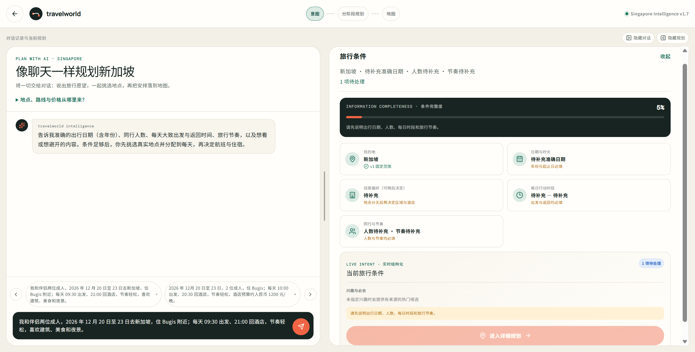

### 图 2 · 确认条件后进入详细规划

发送后，右栏显示 100%，并列出 12 月 20–23 日、两位成人、Bugis 附近、09:30–21:00、轻松节奏和三个兴趣。点击进入详细规划，系统使用已确认的偏好推荐地点。

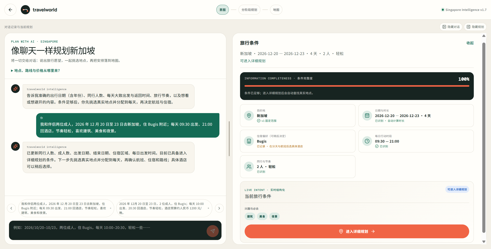

## 2. 挑选真实地点

### 图 3 · 从核实的地点候选开始

候选结合这趟旅行的偏好生成。可按需收起对话栏或规划栏。

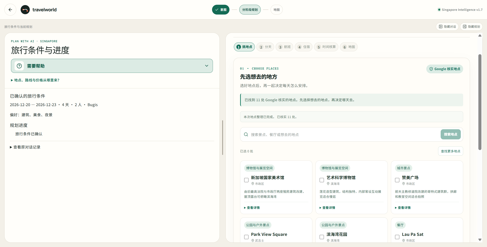

### 图 4 · 挑选想去的地点

喜欢建筑时，可以选艺术科学博物馆和赞美广场。确认清单后，选中的地点进入分天板。

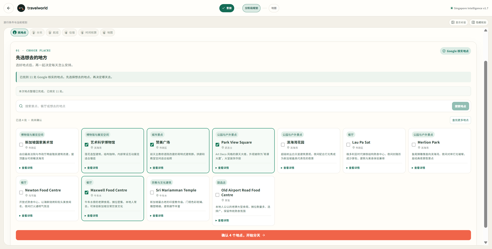

### 图 5 · 查看地点详情和取舍

地点详情展示建议前往的理由、优点和需要留意的条件，供用户决定是否选入。

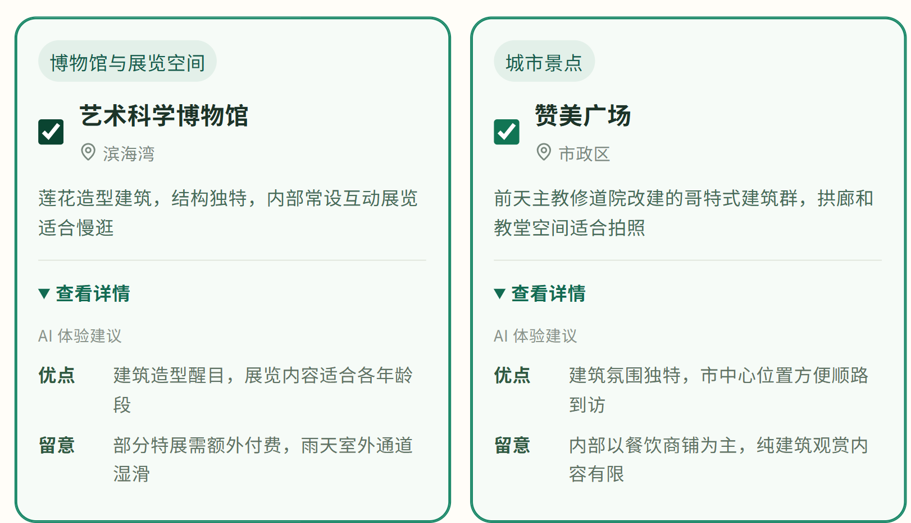

### 图 6 · 随时回看旅行条件和规划进度

左栏保留已确认条件、原对话和当前进度。

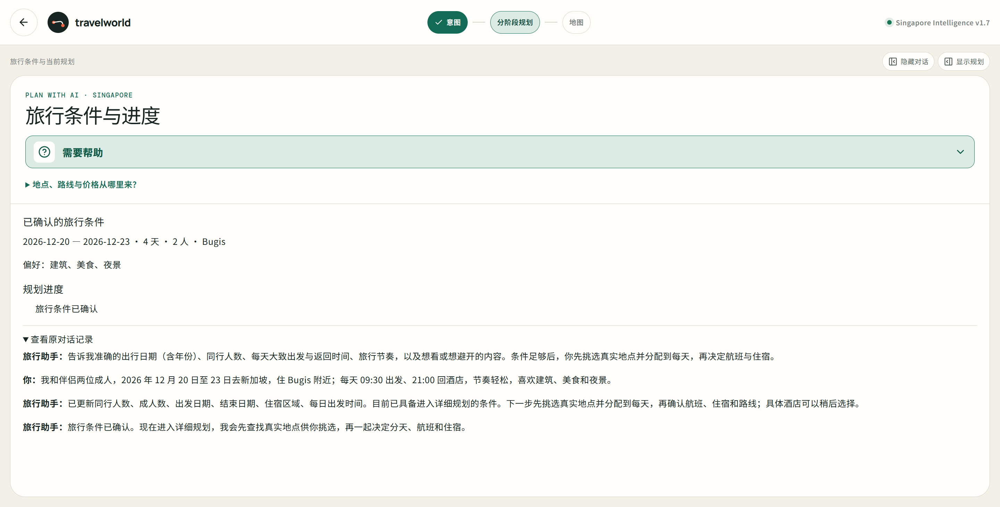

### 图 7 · 按阶段展开只读帮助

截图在「挑地点」阶段展开了左栏「需要帮助」。这里有当前阶段的三个可点问题，例如「我已经选了哪些地点？」。切换阶段后，推荐问题会随规划上下文更新。具体操作由用户在规划区完成。

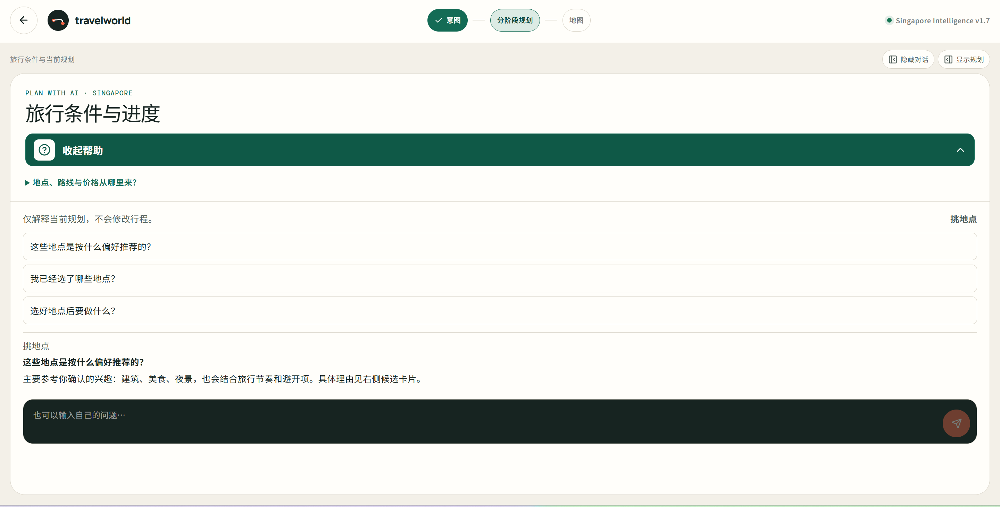

## 3. 把已选地点放进具体日期

### 图 8 · 为每天安排上午和下午

在 Day 1–Day 4 中先选一天，再把待安排地点放入上午或下午。例如把赞美广场放进 Day 1 上午，并把 Park View Square 放进 Day 2。实际可达和营业窗口留到后面核算。

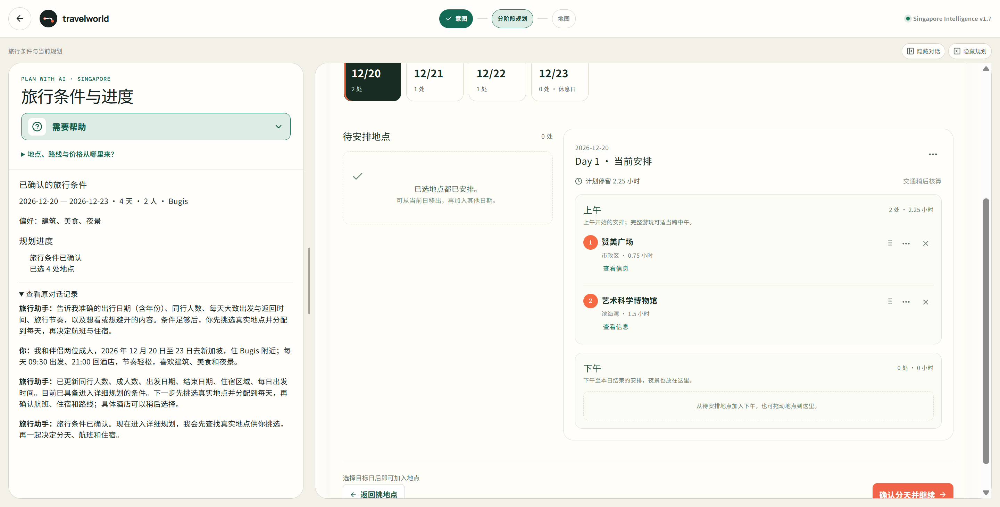

### 图 9 · 确认保留空白日

点击「确认分天并继续」，可返回安排，或确认把空白日保留为休息／自由日。日期保留，离境日仍可核算赴机场交通。


## 4. 确认航班与住宿

### 图 10 · 填写已订机票的四个当地时刻

图中手填的演示时刻为 12 月 20 日 07:00 从上海浦东起飞、12:30 抵达新加坡樟宜，以及 12 月 23 日 20:00 从樟宜返程、次日 01:30 抵达浦东。两小时的抵达机场预留使首日约 14:30 才开始当地路线。真实规划须按机票确认当地日期与时刻。

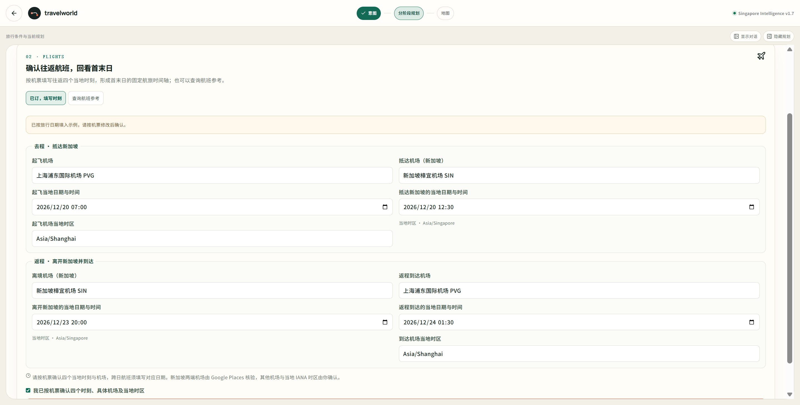

### 图 11 · 查询航班参考

这是另一次用温州机场做的查询，页面按出发日期列过去程和返程候选。去程前一晚出发并在首日抵达的两条候选有结果，首日当天出发没有可用候选，返程返回五条。人数口径、价格和票务条件到预订页核实。本次四日案例使用图 10 的手填时刻。

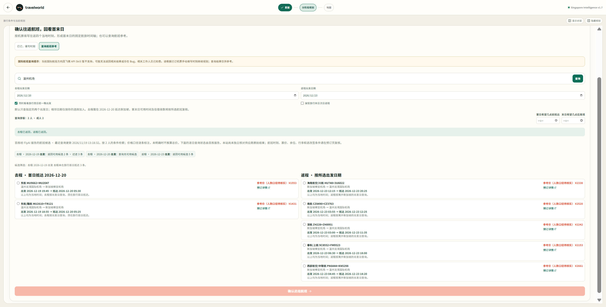

### 图 12 · 比较同住与分段住宿

还没想好住哪里时，先让 AI 按地点分布、住宿夜数和交通估算给建议，也可以直接设置住宿。

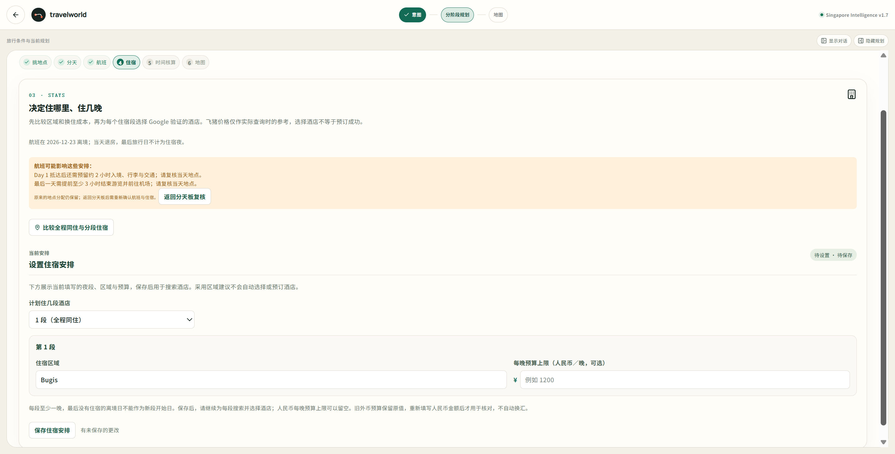

### 图 13 · 查看住宿取舍及交通依据

本例比较全程同住市政区约 47 分钟、Day 3 起换到牛车水约 129 分钟。换住方案含约 90 分钟的行李和入住估算，仅用于比较住宿方案。确认酒店后，每天按实际路线重新核算，酒店办理、寄存及取物由用户自行安排。

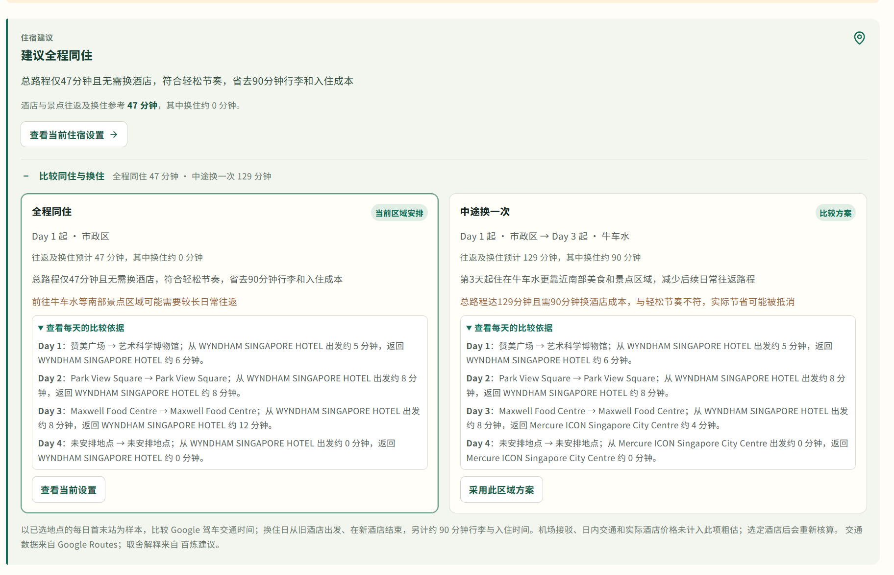

### 图 14 · 设置住宿夜段、区域和预算

可以采用推荐区域或自行指定。12 月 20 日入住、23 日退房共三晚，12 月 23 日的返程仍保留在行程中。

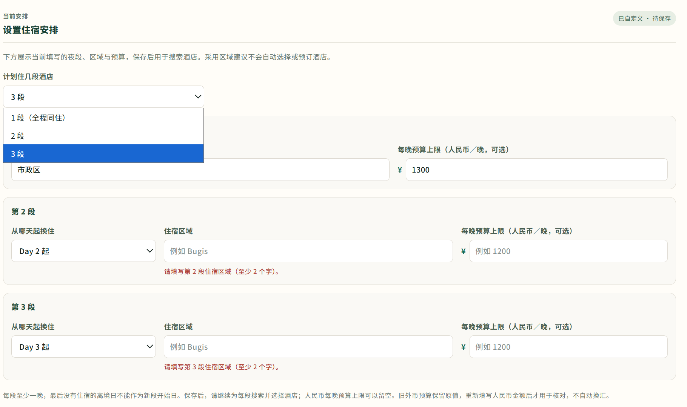

### 图 15 · 正在核对住宿段的酒店与参考价

截图展示市政区 12 月 20 日入住、23 日退房的三晚住宿段正在查询。当前流程由 Google Places 按片区找候选并核实地点，飞猪按已匹配的酒店和住宿日期补参考价。下方是另一次牛车水测试的工具回执。

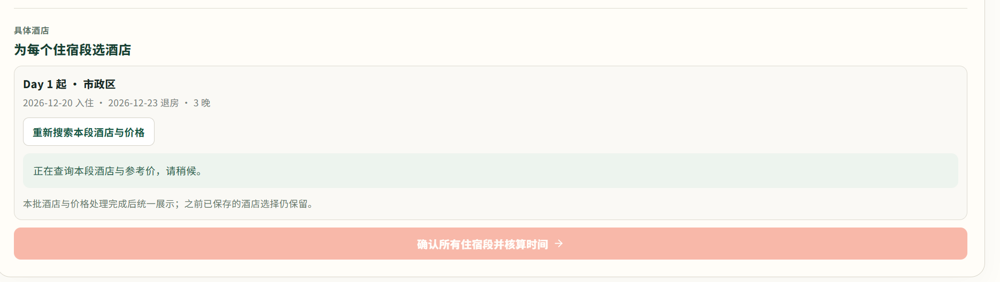

#### 图 15 的工具回执

测试用新加坡牛车水、2026 年 12 月 20–23 日、最高 ¥1300 查询。一次成功调用的原始候选出现了下列跨区记录。

```text
exit 0
status: 0
message: "success"
name: "蜂巢武吉士胶囊酒店"
address: "7A Jalan Pinang"
interestsPoi: "近武吉士街"
```

另一次同条件复测返回 13 家酒店，其中 1 家有较强牛车水线索，8 家位于其他片区，4 家所在片区待核实。工具返回成功表示确实取得候选，区域偏差也已经出现在原始结果里。这次个案促使项目改回 Google Places 按片区找候选，再用飞猪按已匹配酒店查询。价格、房型和库存以预订页面为准。 [住宿搜索回退记录](../fix.md#1119-hotel-search-rollback)

### 图 16 · 比较预算内和其他价位

这次市政区查询处理 5 家，其中 3 家有参考价，2 家查询失败。每晚预算 ¥1300，本批尚未查到可核实的预算内候选。温德姆新加坡酒店的当时参考价为 ¥1445／晚。用户可改预算、换区域，或查看其他候选。

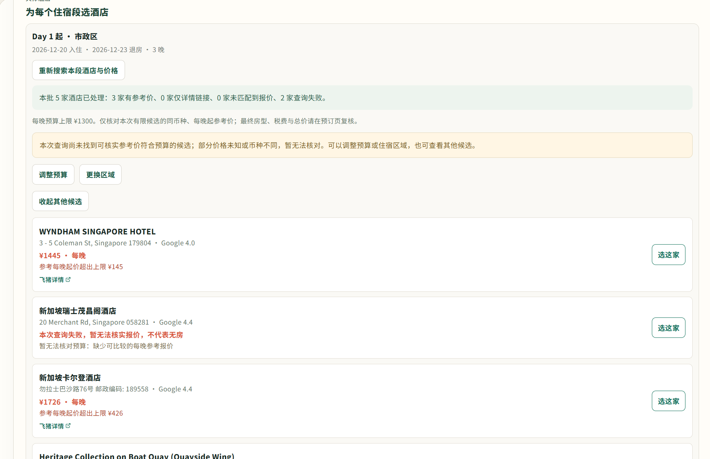

### 图 17 · 超预算候选由用户再次确认

温德姆新加坡酒店的每晚参考价比预算高 ¥145。用户再次确认后，酒店才进入时间核算，作为当天出发、返店或换住的地点。

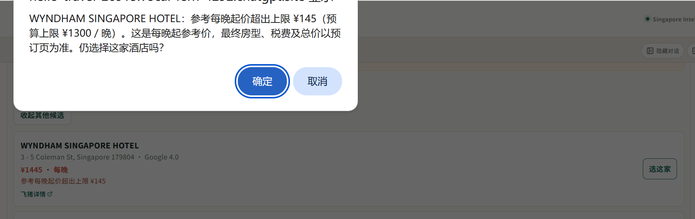

## 5. 先核算全程，再处理冲突

### 图 18 · 一次核对四天，也能逐日查看

截图是首次核算前，四张日期卡都显示「待核算」。可先核对当天，也可点「核对全部旅行日的开放时间与交通余量」，由页面按天给出结果。

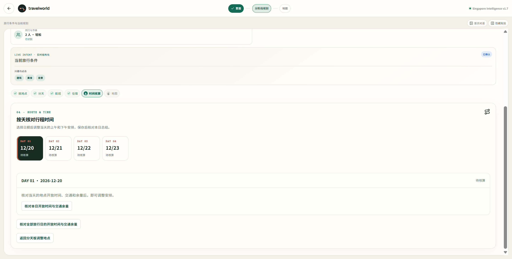

### 图 19 · 首轮核算指出冲突日期、地点和原因

Day 2–Day 4 已核算，Day 1 有冲突。本轮预计 12:30 抵达、14:30 完成机场预留，再加约 51 分钟地面交通，约 15:21 才能到赞美广场，赶不上已选上午。展开「查看本次核算依据」可以看到各项时间与开放信息。

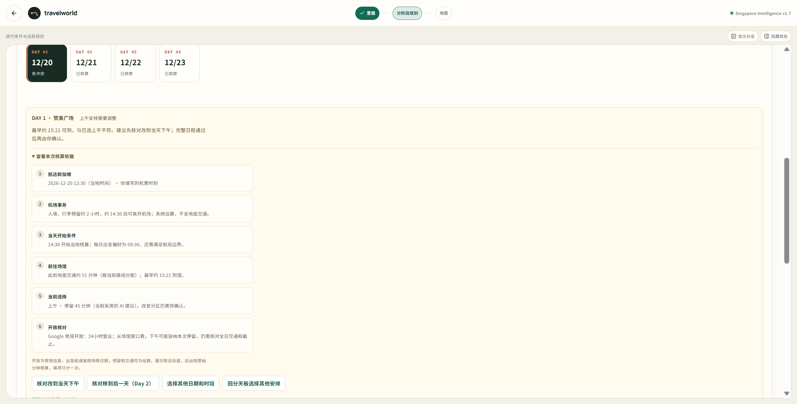

### 图 20 · 只改停留时长，上午冲突仍在

尝试只改赞美广场的停留时长并重算后，这一轮的预计最早到达时刻是 15:11，仍然赶不上上午。右侧就地反馈保留原安排与已填写内容。

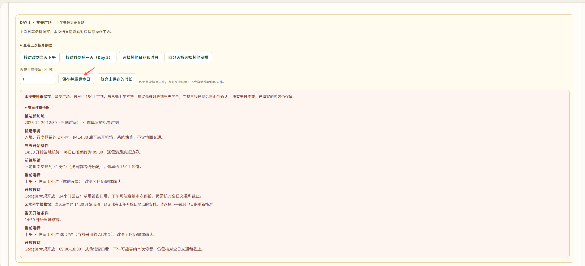

### 图 21 · 预览改到当天下午

把赞美广场拟改到 Day 1 下午，选择保留在待确认列表。同一轮预览指出艺术科学博物馆仍在上午，最早约 15:16 可到，于是可直接从该地点下继续调整。

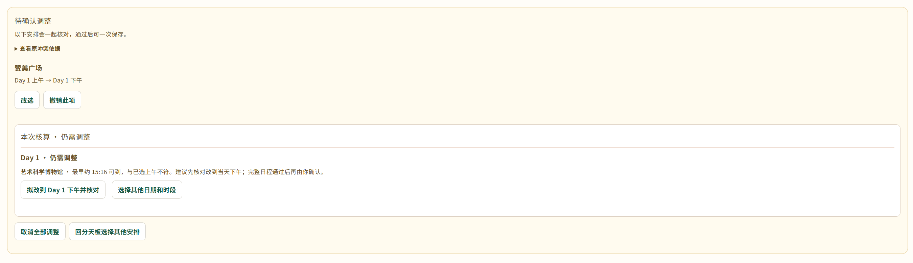

### 图 22 · 两处都改到下午后，预览通过

赞美广场与艺术科学博物馆同时拟改到 Day 1 下午。预览预计 17:56 结束、剩余约 3 小时 4 分钟，出现「确认全部调整」。若选择跨天移动，系统也会分别核对移入和移出的日期。

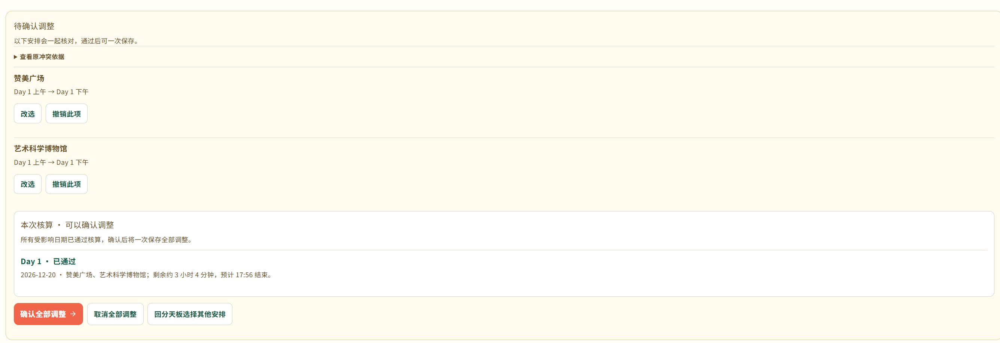

### 图 23 · 用确认后的安排构建时间轴

保存完成后，本例预计 14:59 到温德姆新加坡酒店，15:11 到赞美广场，16:14 到艺术科学博物馆，17:56 返回酒店。以上是本轮依据路线核算的预估值。

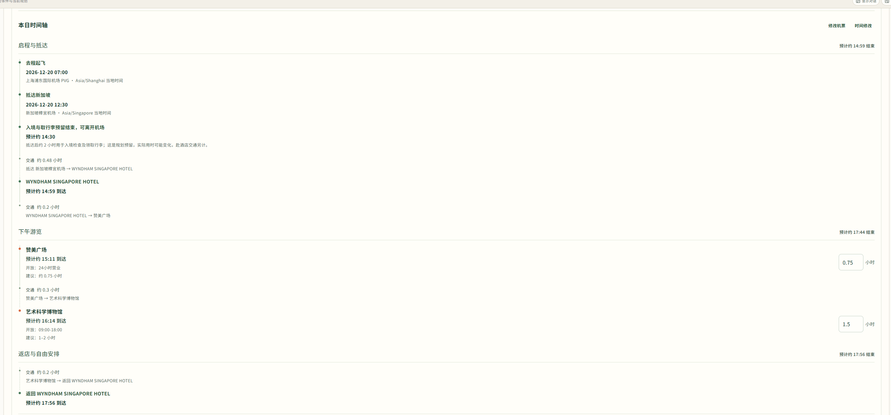

### 图 24 · 核算尚未分配的时间

本例的 Day 1 初始尚未分配时间约 3.07 小时。它是当地时段扣除必要交通、景点停留和已添加活动后的余额，机场预留已计入首末日起止边界。

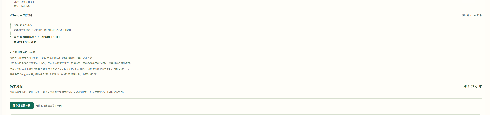

## 6. 给行程留出可编辑的余量

### 图 25 · 分开修改当地时间与机票

画面展示两个独立入口。V40 的「时间修改」允许首日改当地结束时间、末日改当地出发时间。航班约束的一端依旧按已确认时刻和机场预留核算。

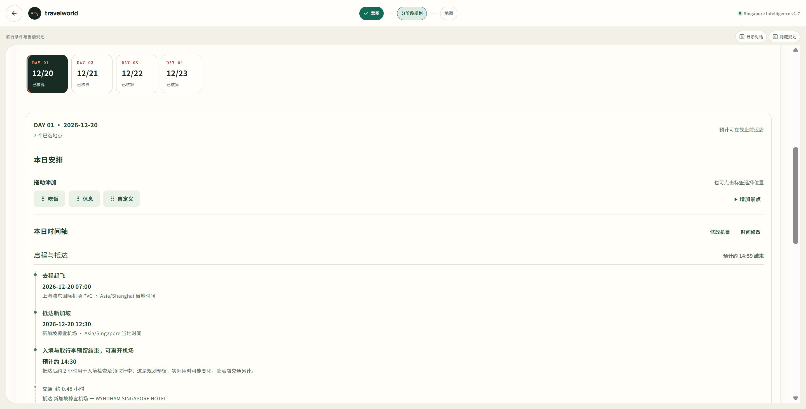

### 图 26 · 添加吃饭、休息或自定义标签

可拖入时间轴，也可点标签选择位置。此处正在填写一项 45 分钟的吃饭安排，可选择放在哪个行程节点前后。

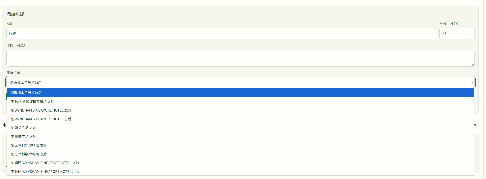

### 图 27 · 吃饭安排已加入，等待保存核算

45 分钟吃饭安排已进入草稿，尚未分配时间标注「待保存并核算」。确认后再更新本日总结；也可编辑、移位、删除或放弃更改。

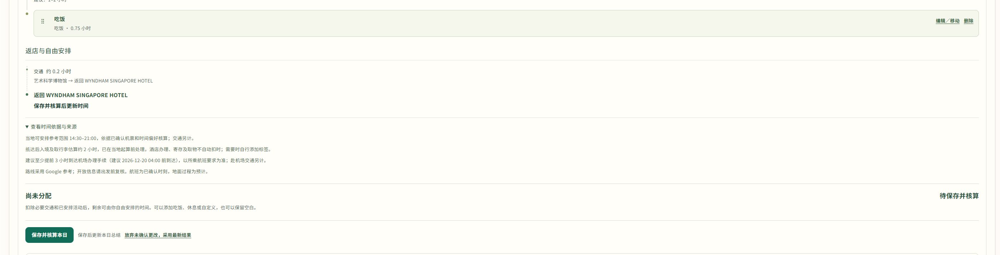

### 图 28 · 从每日总结了解时间分配

图 27 的安排保存后，这次 Day 1 的尚未分配时间从约 3.07 小时降到 2.32 小时，正好少 45 分钟。总结提供活动、交通、剩余时间和节奏建议，帮助决定保留空档还是加一站。

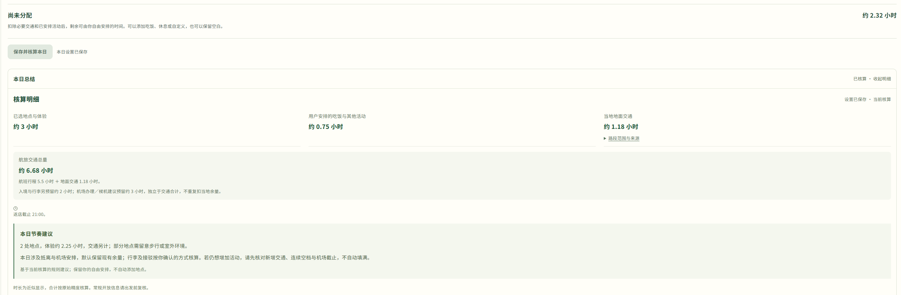

### 图 29 · 全程核算通过后进入地图

日期状态和左侧进度一起显示地点、分天、航班、住宿和时间核算的阶段结果。

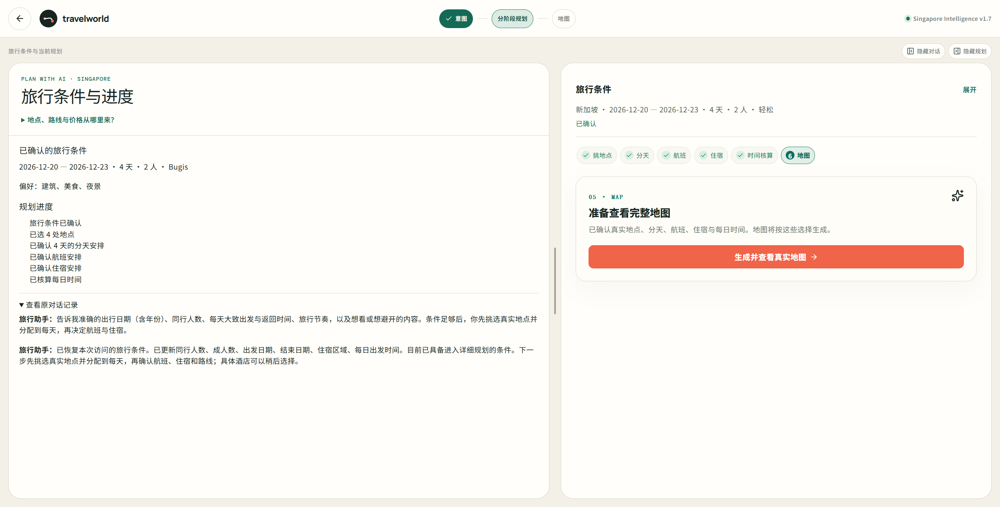

### 图 30 · 回看或修改前序步骤

本例回看的是分天历史版本。Day 1 原排赞美广场和艺术科学博物馆上午，Day 2 是 Park View Square 下午，Day 3 是 Maxwell Food Centre 上午，Day 4 保留为休息／自由日。从这一步重新编辑时，页面提示应复核航班、住宿及时间。

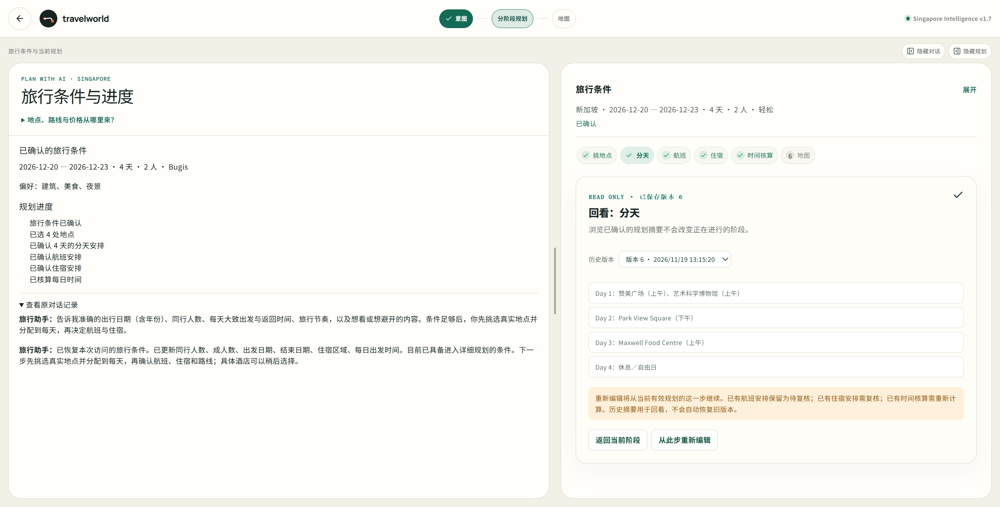

### 图 31 · 刷新后恢复这次访问的旅行条件

画面显示「正在恢复本次访问的旅行条件」。恢复完成后可用本次已经保存的进度继续。

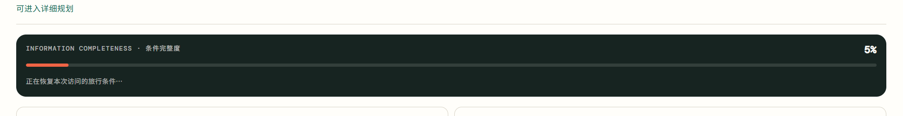

## 7. 用地图出行和分享

### 图 32 · 切换地图中的旅行日

查看每一天的站点顺序、交通和预计耗时，也可从地图或行程卡打开地点详情。

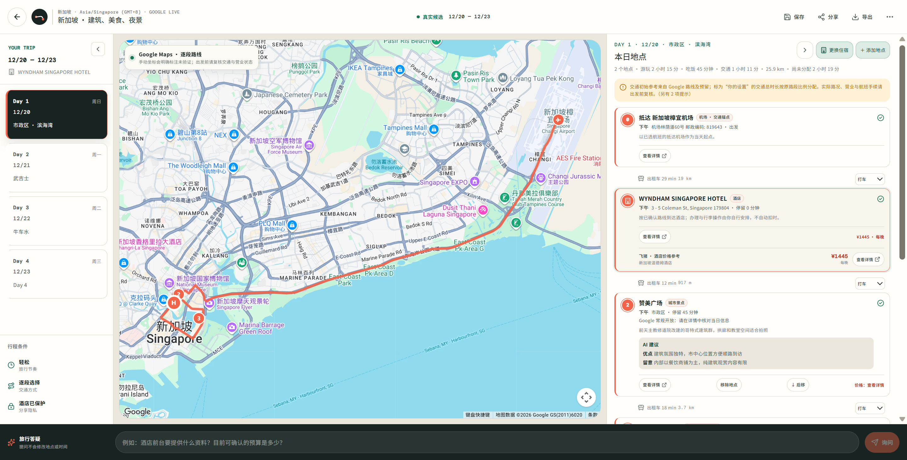

### 图 33 · 查看樟宜机场交通锚点详情

地点面板显示新加坡樟宜机场的名称、机场类别、地址和 Google Maps 入口。本面板的机场信息用于当天的路线锚点，航班与交通价格按各自预订信息核对。

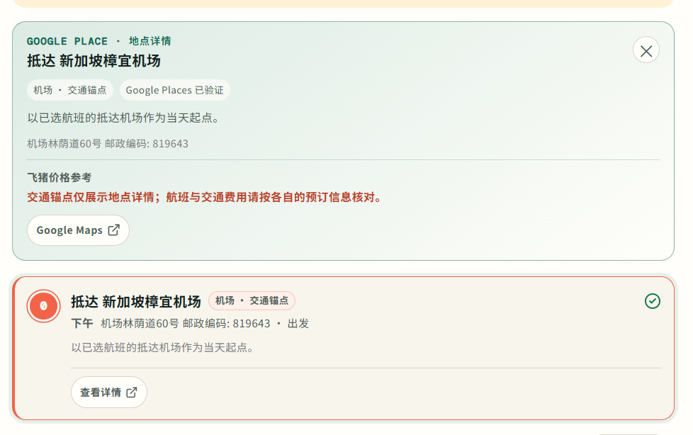

### 图 34 · 查看选定酒店的住宿段和飞猪参考

点击温德姆新加坡酒店可看到 12 月 20–23 日这个住宿段及当时的 ¥1445／晚参考价，页面还提供飞猪详情入口。

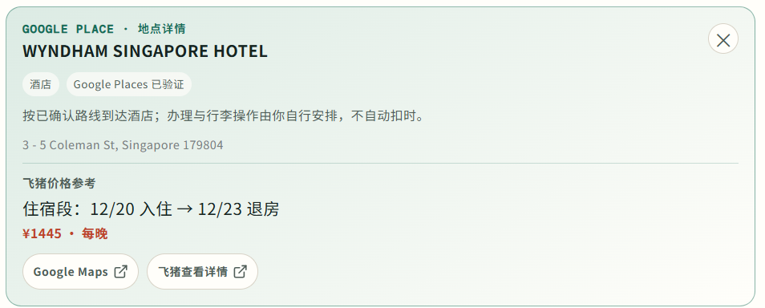

### 图 35 · 在当天地图里提问

本例在 Day 1 的地图中提交「酒店前台要提供什么资料吗」，答疑可使用所选日期及当天站点。

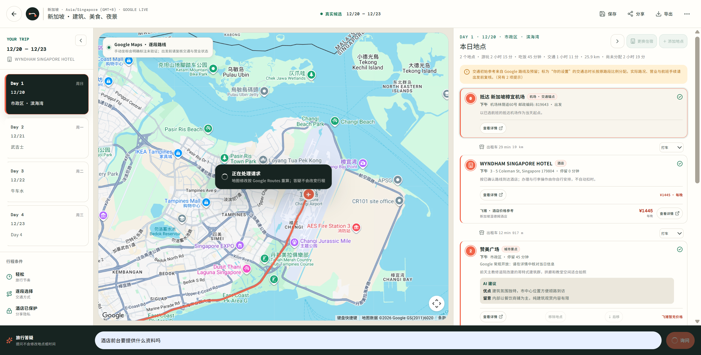

### 图 36 · 结合当天站点与时刻阅读回答

本例回复建议准备每位入住人的有效护照、预订确认及押金担保，具体要求以所选酒店政策与订单为准。

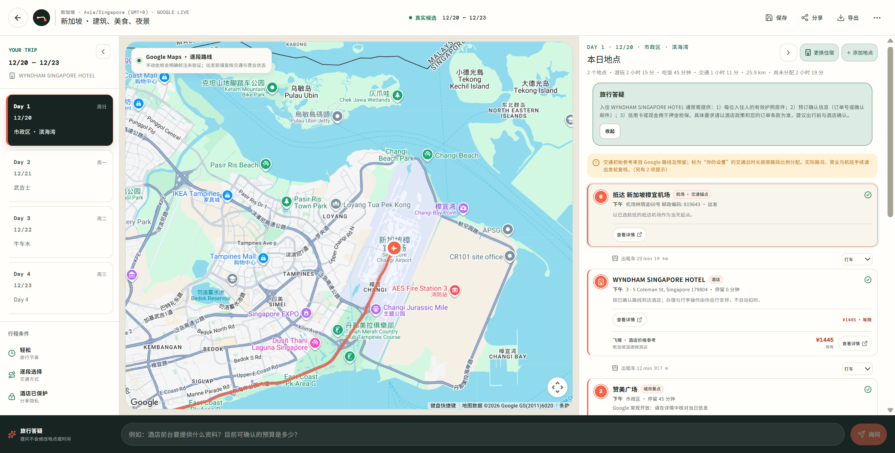

### 图 37 · 保存行程到本设备

保存成功时页面提示行程已存到当前设备，刷新后仍可恢复。

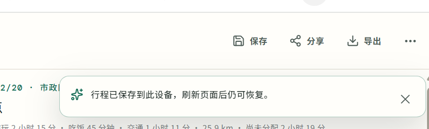

### 图 38 · 预览四日行程的只读分享

确认前可预览接收者看到的四日安排，并选择是否包含住宿和相关路线。画面中已隐藏住宿信息。正式分享链接有效期为 30 天。

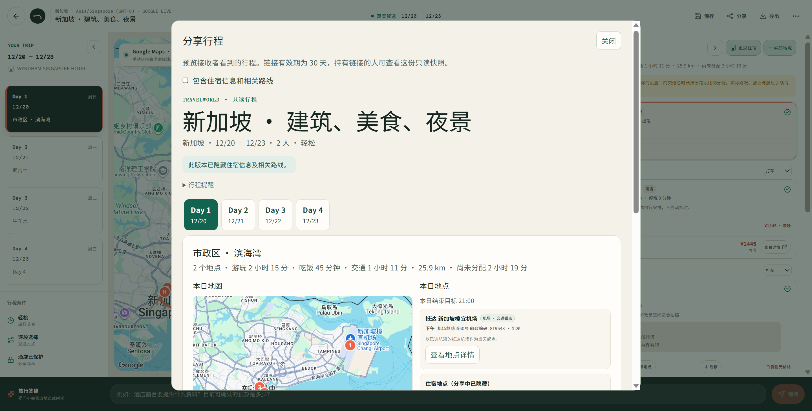
